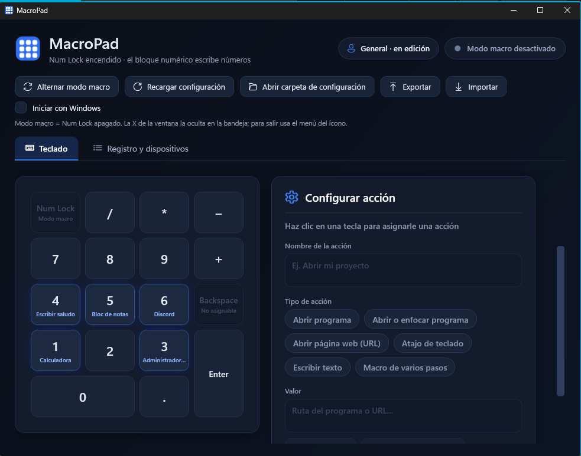

<p align="center">
  
</p>

<h1 align="center">MacroPad</h1>

<p align="center">
  Convierte un teclado numérico externo (o el bloque numérico de tu teclado) en un <b>macro pad programable</b> para Windows.<br>
  Abre programas y páginas, envía atajos, escribe texto y ejecuta macros de varios pasos, con <b>perfiles que cambian según la aplicación activa</b>.
</p>

<p align="center">
  
</p>

---

## Características

- **Asigna una acción a cada tecla** del bloque numérico (`0-9`, `.`, `+`, `-`, `*`, `/` y `Enter`) desde una interfaz visual con el teclado dibujado.
- **Cinco tipos de acción:** abrir un programa, abrir o enfocar un programa, abrir una página web, enviar un atajo de teclado y escribir un texto. Además, **macros de varios pasos** con pausas.
- **Perfiles por aplicación.** El mismo teclado cambia de acciones según la ventana activa (Excel, el navegador, un editor...). Las teclas sin acción en un perfil usan las de *General*. Se pueden **fijar a mano** desde la ventana o desde la bandeja del sistema.
- **Modo macro con Num Lock.** Con Num Lock apagado, el bloque numérico ejecuta tus acciones; encendido, escribe números con normalidad.
- **Sin drivers ni permisos de administrador.** Solo un archivo `.exe`.
- **Evita errores al elegir programas:** lista de programas abiertos, selector de archivos y aviso con sugerencia si un `.exe` está mal escrito.
- **Vive en la bandeja del sistema**, puede iniciar con Windows y solo permite una copia abierta.
- **Exportar e importar** la configuración, con copia de seguridad automática.
- Interfaz oscura con animaciones suaves y notificaciones.

## Instalación

Descarga la última versión desde la sección **[Releases](../../releases)**:

| Archivo | Para quién |
|---|---|
| `MacroPad-Setup-x.y.z.exe` | Instalador. Añade acceso directo y desinstalador. No pide administrador. |
| `MacroPad.exe` | Versión portable, sin instalación. |

La versión autocontenida **no necesita tener .NET instalado**. Funciona en Windows 10 y Windows 11 de 64 bits.

> **Aviso de Windows:** como el ejecutable no está firmado digitalmente, SmartScreen puede mostrar *"Windows protegió su PC"*. Pulsa **Más información → Ejecutar de todos modos**. Algunos antivirus también desconfían de los programas que capturan el teclado de forma global (ver [Cómo funciona](#cómo-funciona)); el código fuente está disponible para revisarlo.

## Uso rápido

1. Abre MacroPad. Verás tu teclado numérico dibujado.
2. Haz clic en una tecla, por ejemplo la **1**.
3. Escribe un nombre, elige el tipo de acción y el valor (por ejemplo, *Abrir programa → Calculadora*). Puedes usar **Examinar** o **Programas abiertos** para no escribir la ruta.
4. Pulsa **Probar** para comprobarla y **Guardar** para activarla.
5. **Apaga Num Lock** y presiona la tecla en tu teclado numérico: se ejecuta la acción.

La ventana se puede cerrar con la **X**: MacroPad sigue funcionando en la bandeja. Para salir del todo, usa clic derecho en su ícono → **Salir**.

### Tipos de acción

| Tipo | Valor | Ejemplo |
|---|---|---|
| Abrir programa | Nombre o ruta del `.exe` | `calc.exe` |
| Abrir o enfocar programa | Igual; si ya está abierto, lo trae al frente | `C:\Users\...\Discord\Update.exe` |
| Abrir página web | URL completa | `https://github.com` |
| Atajo de teclado | Teclas unidas con `+` | `Ctrl+Shift+Esc` |
| Escribir texto | Texto tal cual | `Hola desde MacroPad` |
| Macro de varios pasos | Un paso por línea (ver abajo) | |

### Macros de varios pasos

Una línea por paso. Las líneas que empiezan con `#` son comentarios.

```text
# Abre el Bloc de notas y escribe un saludo
abrir: notepad.exe
esperar: 1500ms
escribir: Hola desde MacroPad
atajo: Ctrl+A
```

| Paso | Qué hace |
|---|---|
| `abrir: programa` | Abre un programa |
| `enfocar: programa` | Abre el programa o, si ya está abierto, lo trae al frente |
| `url: dirección` | Abre una página web |
| `atajo: Ctrl+S` | Envía un atajo de teclado |
| `escribir: texto` | Escribe un texto |
| `esperar: 2s` | Pausa (también `500ms` o `1500`, en milisegundos) |

Al guardar, MacroPad revisa el guion y señala la línea exacta si hay un error.

### Perfiles

- **General** siempre existe y sirve de respaldo.
- Crea más perfiles con **Nuevo** y, en *Se activa con*, indica los programas (`excel, winword`) o elígelos con **Programas abiertos**.
- Al presionar una tecla, se usa el perfil del programa que tengas en primer plano. Si ese perfil no tiene acción en la tecla, se usa la de *General*.
- **Fijar este perfil** (o el menú **Perfil** de la bandeja) ignora la ventana activa hasta que vuelvas a *Automático*.

## Configuración

Todo se guarda en `%AppData%\MacroPad\config.json`. Puedes editarlo a mano o usar **Recargar configuración**. Cada cambio hecho desde la interfaz deja una copia anterior en `config.json.bak`.

```json
{
  "Profiles": [
    {
      "Name": "General",
      "Apps": [],
      "Bindings": {
        "NumPad1": { "Name": "Calculadora", "Type": "OpenProgram", "Value": "calc.exe" },
        "NumPad2": { "Name": "GitHub", "Type": "OpenUrl", "Value": "https://github.com" }
      }
    },
    {
      "Name": "Excel",
      "Apps": [ "excel" ],
      "Bindings": {
        "NumPad1": { "Name": "Guardar", "Type": "SendShortcut", "Value": "Ctrl+S" }
      }
    }
  ],
  "PinnedProfile": null
}
```

Valores de `Type`: `OpenProgram`, `FocusProgram`, `OpenUrl`, `SendShortcut`, `TypeText`, `Sequence`.

## Cómo funciona

- **Captura del teclado:** un *hook global de teclado de bajo nivel* (`WH_KEYBOARD_LL`) intercepta el bloque numérico mientras el modo macro está activo y **bloquea** la tecla para que no escriba el número. Es lo que permite funcionar sin instalar drivers.
- **Modo macro = Num Lock apagado.** Se lee el estado real de Num Lock en Windows, así nunca se desincroniza. Con Num Lock apagado, el bloque numérico envía teclas de navegación (`End`, `PgDn`...) sin el indicador de tecla extendida; MacroPad las reconoce y las traduce a `NumPad1`, `NumPad3`... para distinguirlas de la cruceta real.
- **Ejecución:** los atajos y el texto se envían con `SendInput`; los programas, con `Process.Start`. Las acciones corren en segundo plano para que el hook responda siempre al instante.
- **Perfil activo:** se obtiene el proceso de la ventana en primer plano (`GetForegroundWindow`) y se compara con los programas de cada perfil.
- **Enfocar ventanas:** se usa `AttachThreadInput` y `SetForegroundWindow` para sortear la restricción de Windows sobre quién puede pasar al frente.
- **Interfaz:** WPF con estilos y plantillas propias (tema oscuro, animaciones, notificaciones).

### Decisión de diseño: ¿por qué no un driver?

Distinguir *qué teclado* envió cada tecla exige un driver de filtro como [Interception](https://github.com/oblitum/Interception), que requiere permisos de administrador, reinicio y suele ser marcado por antivirus y sistemas anti-trampas. Se descartó para que MacroPad sea fácil de instalar y probar. El precio es una limitación consciente (ver abajo).

## Limitaciones conocidas

- **No distingue entre teclados.** Con el modo macro activo, el bloque numérico de tu teclado principal también ejecuta acciones. Por eso existe el interruptor con Num Lock.
- El `Backspace` del numérico no se puede asignar: envía el mismo código que el del teclado principal.
- Las **apps de la Tienda de Windows** (Calculadora moderna, Configuración...) se identifican a través de un proceso intermedio, por lo que no se pueden asociar a un perfil.
- Todas las pestañas de un navegador comparten el mismo perfil.
- Es posible que no funcione mientras tienes en primer plano una ventana abierta como administrador (limitación de Windows).
- Los juegos con sistemas anti-trampas podrían objetar un hook global de teclado.
- Solo Windows 10/11 de 64 bits.

## Compilar desde el código

Requisitos: **Windows 10/11**, **Visual Studio 2022** con la carga de trabajo *Desarrollo de escritorio de .NET* (o el SDK de .NET 8 o superior, según el `TargetFramework` de `MacroPad.csproj`).

```bash
git clone https://github.com/RudySebastian18/MacroPad.git
cd MacroPad
dotnet run --project MacroPad
```

### Generar el ejecutable

```bash
publicar.bat           # MacroPad.exe autocontenido  -> publish\win-x64\
publicar.bat ligero    # MacroPad.exe ligero (requiere .NET Desktop Runtime) -> publish\ligero\
```

### Generar el instalador

1. Instala [Inno Setup](https://jrsoftware.org/isinfo.php) 6.3 o superior.
2. Ejecuta `publicar.bat`.
3. Abre `installer\MacroPad.iss` y compila (**Build → Compile**). El instalador queda en `installer-output\`.

## Estructura del proyecto

| Archivo | Qué hace |
|---|---|
| `App.xaml` / `App.xaml.cs` | Arranque de la aplicación y control de **instancia única** |
| `MainWindow.xaml` / `.xaml.cs` | Interfaz, teclado dibujado, perfiles, animaciones y bandeja del sistema |
| `KeyboardHook.cs` | Hook global de teclado (`WH_KEYBOARD_LL`) |
| `ActionEngine.cs` | Ejecuta las acciones (`SendInput`, procesos, enfocar ventanas) e interpreta las macros |
| `ConfigManager.cs` | Lee y guarda `config.json`, perfiles, migración de formato y copias de seguridad |
| `ProgramTools.cs` | Lista de programas abiertos, comprobación de `.exe` y sugerencias de corrección |
| `RawInputManager.cs` | Lista los teclados conectados (Raw Input) |
| `AutoStart.cs` | Inicio con Windows (`HKCU\...\Run`, sin administrador) |
| `AppIcon.cs` | Dibuja el ícono de la aplicación por código |

## Ideas a futuro

- Reconocer teclados distintos sin driver (por ejemplo, con Raw Input combinado con otro método de bloqueo).
- Acciones nuevas: control de volumen, medios, portapapeles y movimiento del mouse.
- Capas adicionales por tecla modificadora.
- Soporte para teclados macro con más teclas y para un tema claro.

## Licencia

Distribuido bajo la licencia **MIT**. Consulta el archivo [LICENSE](LICENSE).
